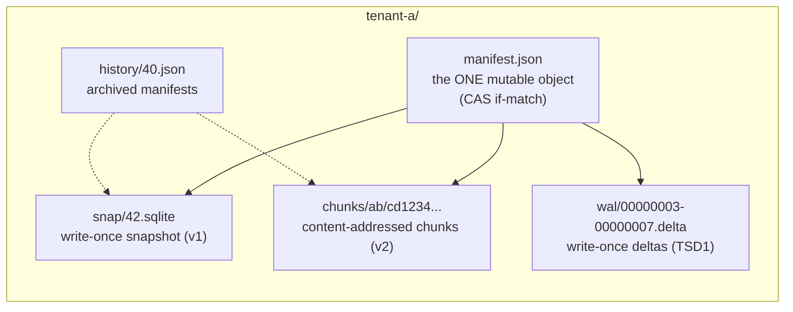
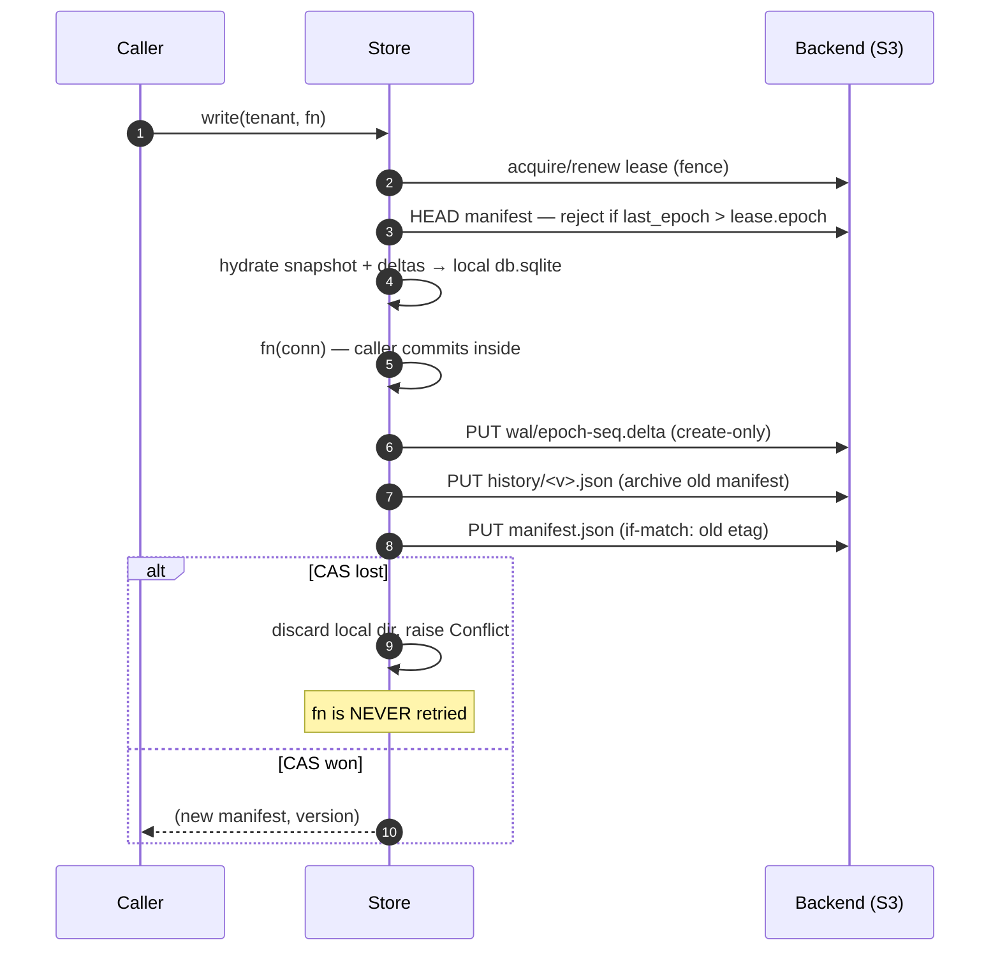
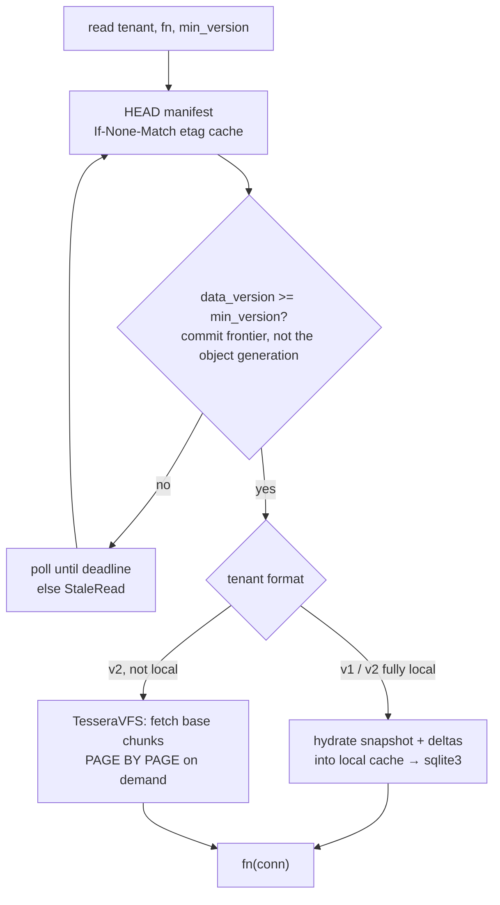
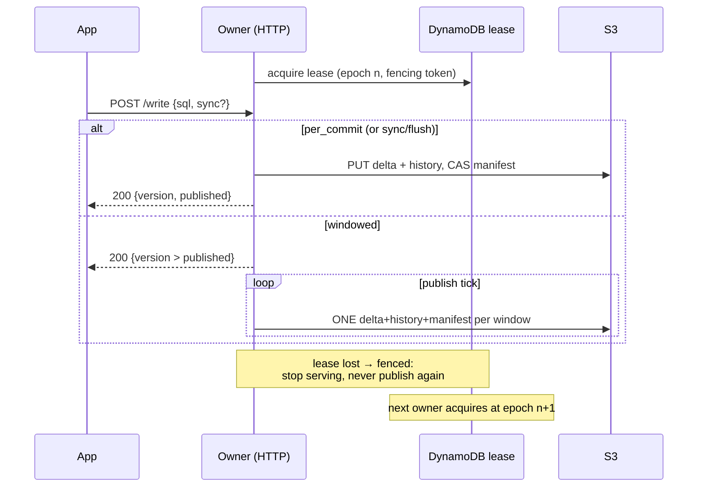

# How it works

Everything is objects in a backend namespace (`LocalBackend` for dev,
`S3DynamoBackend` on AWS). There is exactly **one mutable object** per
tenant — the manifest — and every mutation is a conditional write.

## Object layout

The manifest pins a snapshot (v1) or a content-addressed chunk set (v2)
plus the delta chain since. Deltas are `TSD1` frame sets — WAL frames
captured *before* the committing connection checkpoints and deletes them.

## Write path (`Store.write`)

On CAS failure the local copy is destroyed before `Conflict` propagates —
the local database can never drift ahead of the committed manifest.

## Read path

Reads never touch leases. VFS reads need the `vfs` extra (APSW); without
it, v2 reads fall back to full hydration — slower, still correct.

## Hot owner (fenced write path)

For sustained writes a per-tenant `Owner` holds a DynamoDB-fenced lease
and serves HTTP `/write`. Two publish modes:

- `per_commit` (default): `/write` commits locally **and** waits for the
  delta + history + manifest CAS round-trip before ACKing — the response
  is durable on return.
- `windowed`: `/write` ACKs at local commit; the background loop folds
  every commit inside `publish_every_s` into ONE publish (bounded
  durability window — commits ahead of the `published` floor are lost if
  the owner's WAL is discarded before the flush). `sync: true` on
  `/write` or `POST /flush` forces an immediate publish.

A fenced owner can keep its HTTP server but stops accepting writes (409)
and exits its loop — a stale epoch can never CAS over a newer manifest.

## Recovery

- `read_at(tenant, version)` / `history(tenant)` — archived manifests under
  `history/` keep deleted deltas addressable for `gc_keep_history` days.
- `restore` — copies the tenant to `<tenant>@v<n>` and hydrates that
  version; the live tenant is untouched.
- `clone` / `export` — materialize any version as a standalone sqlite file.
- `gc` — mark & sweep: objects referenced by the live manifest OR any
  archived manifest survive; the rest is deleted past a grace window.
